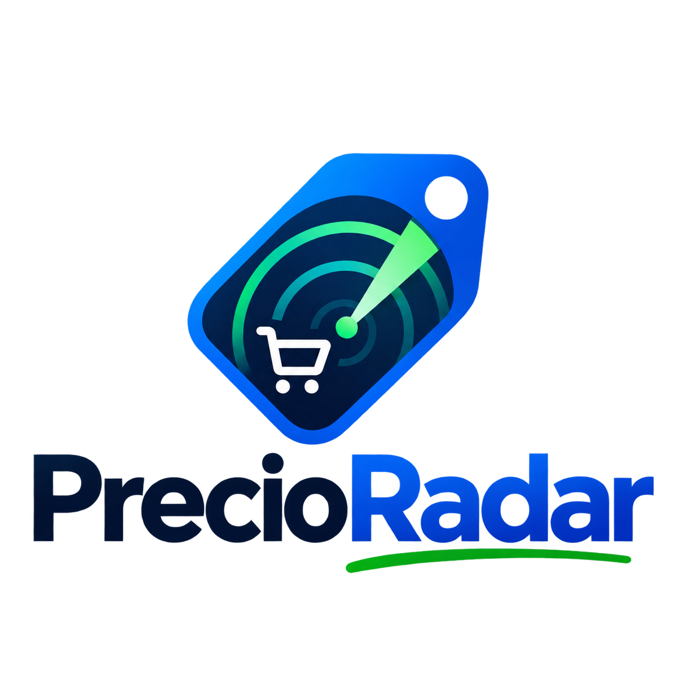
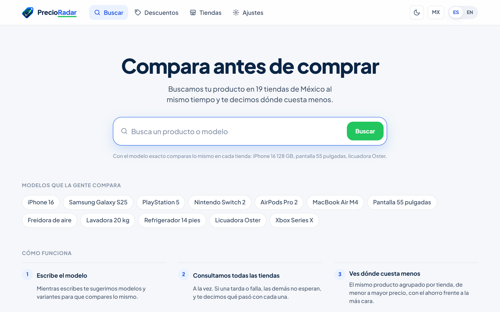
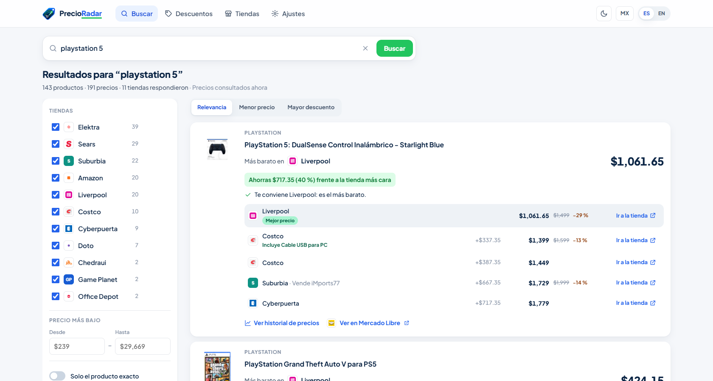
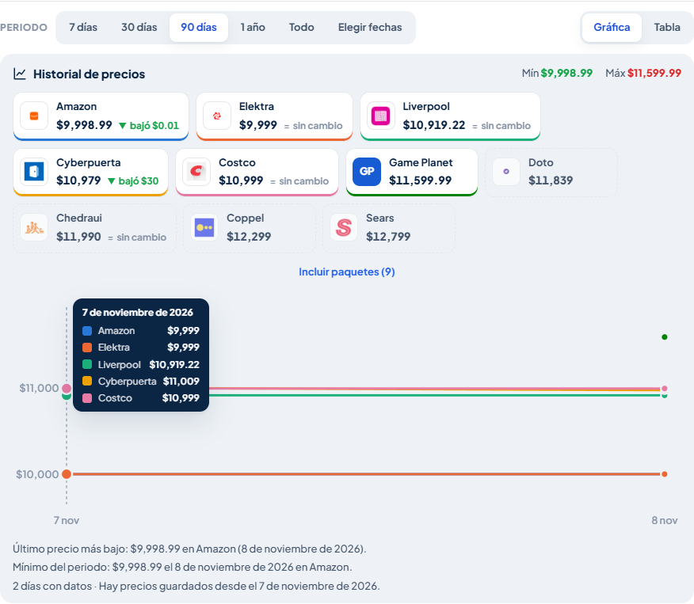
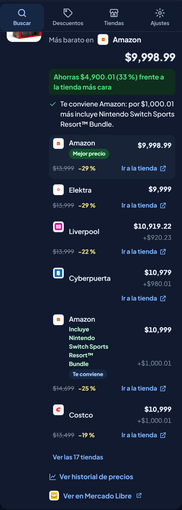
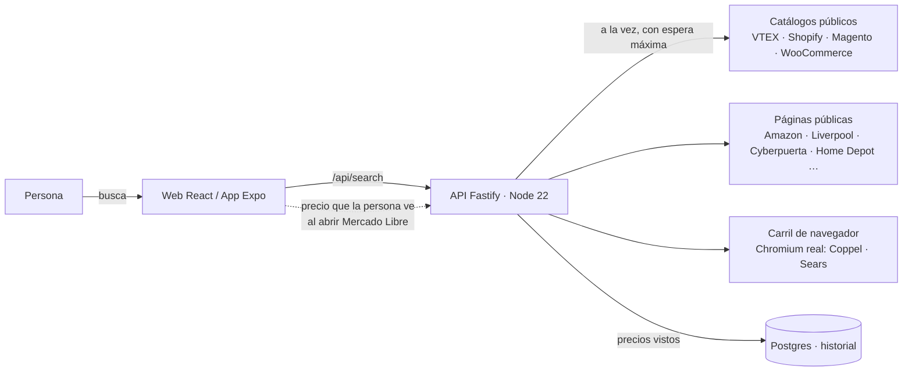

<p align="center">
  
</p>

<h1 align="center">PrecioRadar</h1>
<p align="center"><b>Compara precios. Decide mejor.</b><br>
Busca un producto y compara su precio en 21 tiendas de México al mismo tiempo, con historial para saber si la oferta es real.</p>

<p align="center">
  <a href="https://precioradar-701205043940.us-central1.run.app">Abrir la app</a> ·
  <a href="#cómo-funciona">Cómo funciona</a> ·
  <a href="#correrlo-en-tu-computadora">Correrlo en tu computadora</a> ·
  <a href="#decisiones-que-vale-la-pena-contar">Decisiones</a> ·
  <a href="#english-summary">English</a>
</p>



## Qué hace

- **Busca en 21 tiendas a la vez** (Amazon, Liverpool, Suburbia, Costco, Elektra, Chedraui, Office Depot, Cyberpuerta, iShop, Doto, Steren, Game Planet, Coppel, Sears y más) y te dice **dónde cuesta menos**. Si una tienda tarda o falla, las demás no esperan, y la app te dice qué pasó con cada una.
- **Agrupa el mismo producto** aunque cada tienda lo nombre distinto: "Nintendo Switch 2, 256GB, Wi-Fi, Negro" y "Consola Nintendo Switch 2 de 256 GB edición estándar" son el mismo producto; "16 Plus" no es "16"; una microSD "para Switch 2" no es la consola.
- **Te dice qué te conviene**: el más barato, o el paquete que por poco más incluye un juego o una garantía.
- **Historial de precios** por tienda y periodo (7 días a todo lo guardado), con si bajó ▼, subió ▲ o sigue igual =, en gráfica y tabla.
- **Lo que buscas, primero**: al buscar "PlayStation 5" la consola va antes que sus juegos y controles.
- **Honesta con sus límites**: si una tienda no contestó ahora, enseña su último precio guardado con fecha y "sin verificar"; las tiendas que bloquean lectores automáticos aparecen como bloqueadas, con el motivo.
- Tema claro y oscuro, español e inglés, web y app de celular (Expo).

| Resultados | Historial | Teléfono |
|---|---|---|
|  |  |  |

## Cómo funciona



La API sigue **arquitectura hexagonal**: el *dominio* (texto, relevancia, agrupación, paquetes, recomendación) no conoce tiendas ni HTTP; la *aplicación* orquesta (búsqueda, historial, enlaces, observaciones); la *infraestructura* son los adaptadores de cada tienda, Postgres y el navegador; las *interfaces* son las rutas. Agregar una tienda VTEX, Shopify, Magento o WooCommerce es un renglón en `api/src/infrastructure/stores/registry.ts`.

```
api/      Servidor TypeScript (Fastify). Consulta, califica, agrupa, recuerda. 111 pruebas (Vitest).
web/      App web (Vite + React 19). La sirve el mismo servidor en producción.
mobile/   App de celular (Expo SDK 58, expo-router). Misma API, mismo contrato.
shared/   Contrato de datos y reglas compartidas entre los tres.
docs/     Capturas, bitácora técnica completa y material de publicación.
```

Cada búsqueda guarda los precios vistos; un trabajo diario vuelve a consultar las búsquedas más repetidas para que el historial crezca aunque nadie entre.

## Correrlo en tu computadora

Requisitos: Node 22.18 o más reciente. Sin base de datos funciona igual (el historial vive en memoria).

```bash
# 1) Servidor
cd api && npm install && npm run dev        # http://localhost:4000

# 2) Web
cd web && npm install && npm run dev        # http://localhost:5173 (habla con el servidor del paso 1)

# 3) App de celular (opcional)
cd mobile && npm install && npx expo start  # escanea el QR con Expo Go
```

Pruebas: `npm test` en `api/` y `web/`; `npm run typecheck` y `npm run lint` en cada carpeta.

Variables opcionales en `api/.env` (ver `api/.env.example`): `DATABASE_URL` para Postgres, `MELI_CLIENT_ID`/`MELI_CLIENT_SECRET` de Mercado Libre, `STORE_TIMEOUT_MS`, y el carril de navegador (`BROWSER_STORES_OFF`, `PLAYWRIGHT_CHROMIUM`). Ninguna llave va al repositorio.

## Despliegue

Una sola imagen (`Dockerfile`, base oficial de Playwright con Chromium) corre en Cloud Run y sirve API y web. `desplegar-gcp.ps1` es idempotente: habilita APIs, crea la base, guarda credenciales en Secret Manager, construye con Cloud Build, despliega y programa el refresco diario con Cloud Scheduler. Los detalles, costos y cada decisión están en [`docs/BITACORA.md`](docs/BITACORA.md).

## Decisiones que vale la pena contar

- **Solo páginas y APIs públicas.** Si una tienda responde con un muro anti-robots, se reporta como bloqueada y no se insiste ni se intenta brincar: nada de proxies, huellas falsas ni captchas. Para esas tiendas el camino es su programa de afiliados.
- **Mercado Libre cerró su búsqueda a aplicaciones externas** (2025). La app está registrada y sus llaves funcionan, pero el buscador contesta 403 y el catálogo viene sin precios. En vez de rodearlo: cada producto trae un enlace a su página en Mercado Libre, y en la app de celular el **precio que la persona ve al abrirlo se comparte con los demás**, con fecha y con su permiso.
- **Amazon contesta desde la nube la mitad de las veces** (captcha intermitente). La búsqueda guarda la última respuesta buena de cada tienda y, si falla ahora, la enseña diciendo de hace cuánto es.
- **Agrupar es lo difícil.** Código de barras y claves de modelo cuando existen; si no, marca + especificaciones (capacidad, pulgadas, letra de modelo) con título parecido y precio creíble. Colores, "Wi-Fi" y "edición estándar" no cuentan; "Plus", "Pro" y "16e" sí.
- **Una sola regla de color en las gráficas**: paleta de 8 colores validada para daltonismo, un color por tienda, nunca más de 8 series a la vez.

## Lo que sigue

Dominio propio, inicio de sesión con favoritos y alertas de precio, extensión de navegador para compartir el precio de Mercado Libre desde la web, publicación de la app en las tiendas.

## Licencia

MIT. Los logotipos de las tiendas pertenecen a sus dueños y se usan solo para identificarlas. Los precios los publica cada tienda; aquí solo se comparan.

---

## English summary

**PrecioRadar** searches a product across 21 Mexican stores at once, groups the same product even when stores name it differently, tells you where it costs less and whether a bundle is worth it, and keeps a daily price history (with up/down arrows) so you can tell a real deal from a fake one.

Stack: TypeScript everywhere. Fastify API on Node 22 (hexagonal architecture, 111 tests), Vite + React 19 web, Expo SDK 58 mobile app, Postgres on Cloud SQL, one Docker image on Cloud Run (Playwright base, so a real Chromium reads the two stores whose pages render client-side), Cloud Scheduler for the daily refresh.

Principles: public pages and APIs only, never bypass anti-bot walls; when a store blocks, say so. Mercado Libre closed its search API to third parties, so the mobile app lets the user open the product page and share the price they see, with consent and a timestamp. Amazon answers from the cloud about half the time, so the last good answer per store is remembered and shown with its age.

Run it: `cd api && npm install && npm run dev`, then `cd web && npm install && npm run dev`. No database required for local use.
